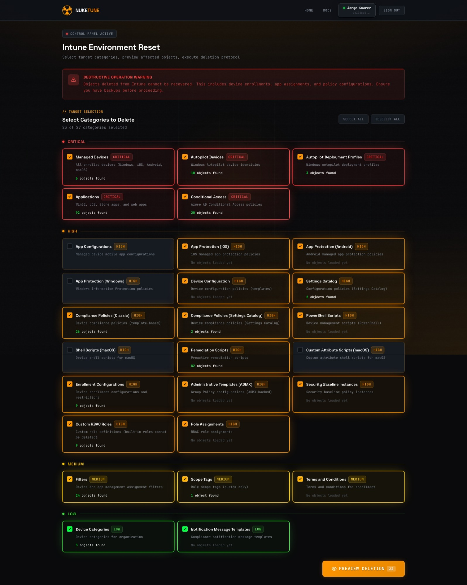
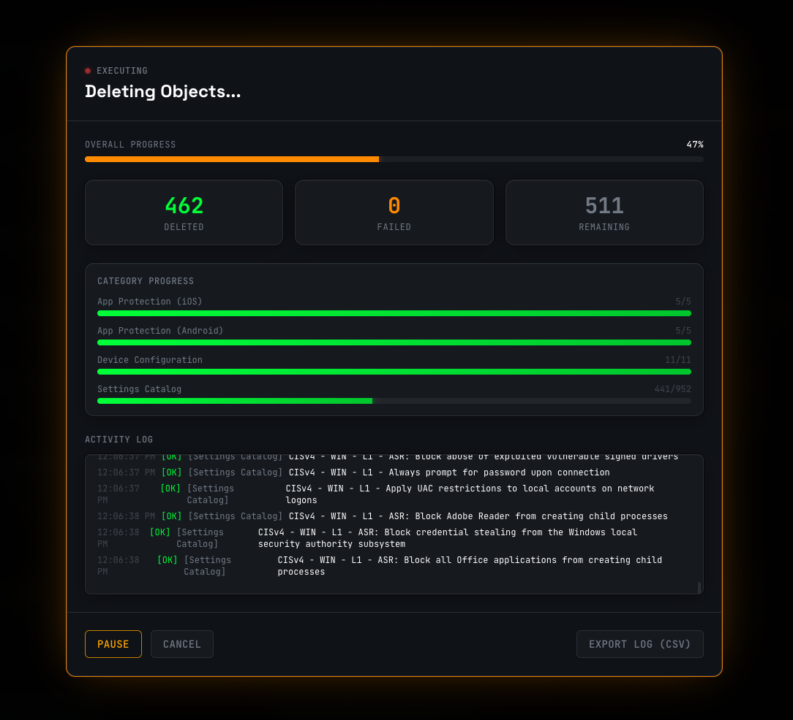

<p align="center">
  
</p>

# NukeTune


Bulk deletion tool for Microsoft Intune environments. Reset your tenant by removing devices, apps, policies, and configurations in one operation.

**Live**: [nuketune.com](https://nuketune.com)

## Screenshots

<p align="center">
  
</p>

<p align="center">
  
</p>

## Features

- Delete objects across 28 Intune categories
- Microsoft Global Commercial Intune support
- Preview before deletion
- Progress tracking and deletion logs
- No app registration required (multitenant)

## Supported Categories

| Critical | High | Medium/Low |
|----------|------|------------|
| Managed Devices | App Configurations | Filters |
| Autopilot Devices | App Protection (iOS, Android, Windows) | Scope Tags |
| Autopilot Deployment Profiles | Device Configuration | Device Categories |
| Applications | Settings Catalog | Terms and Conditions |
| Conditional Access | Compliance Policies (Classic, Settings Catalog) | Notification Message Templates |
| Entra ID Groups | PowerShell Scripts | |
| | Shell Scripts (macOS) | |
| | Remediation Scripts | |
| | Custom Attribute Scripts (macOS) | |
| | Enrollment Configurations | |
| | Administrative Templates (ADMX) | |
| | Security Baseline Instances | |
| | Custom RBAC Roles & Role Assignments | |

## Usage

1. Go to [nuketune.com](https://nuketune.com)
2. Click **Sign in with Microsoft**
3. Authenticate to your Global Commercial tenant and grant consent (if prompted)
4. Select categories to delete
5. Click **Preview Deletion** to review objects
6. Type `DELETE` to confirm

## Requirements

- Intune Administrator or Global Administrator role
- Microsoft Intune tenant in the Global Commercial cloud; sovereign clouds are not supported
- Admin consent for required permissions (prompted on first sign-in)

## Required Permissions

Delegated Microsoft Graph scopes requested at sign-in:

| Permission | Purpose |
|------------|---------|
| User.Read | Signed-in user profile |
| DeviceManagementManagedDevices.ReadWrite.All | Devices, device categories |
| DeviceManagementServiceConfig.ReadWrite.All | Autopilot, enrollment, terms and conditions, notification templates |
| DeviceManagementConfiguration.ReadWrite.All | Configuration, compliance and baseline policies, filters |
| DeviceManagementApps.ReadWrite.All | Applications, app configuration and protection |
| DeviceManagementScripts.ReadWrite.All | PowerShell, shell, remediation and custom attribute scripts |
| DeviceManagementRBAC.ReadWrite.All | Scope tags, roles and role assignments |
| Group.ReadWrite.All | Entra ID Groups |
| Policy.ReadWrite.ConditionalAccess | Conditional Access |
| Policy.Read.All | Reading Conditional Access policies |

## Local Development

```bash
# Install dependencies (Node 22)
npm ci

# Set environment variables
cp .env.example .env
# Edit .env with your values

# Run dev server
npm run dev
```

Runs on `http://localhost:4000`

```bash
# Lint + typecheck, tests, production build (CI runs the same steps)
SKIP_ENV_VALIDATION=1 npm run check
npm test
SKIP_ENV_VALIDATION=1 npm run build
```

## Environment Variables

```
NEXT_PUBLIC_MSAL_CLIENT_ID=your-app-id
NEXT_PUBLIC_MSAL_REDIRECT_URI=http://localhost:4000
```

## Warning

**This tool performs irreversible deletions.** Only use on test/dev tenants unless you fully understand the consequences. Always back up important configurations before proceeding.

## License

MIT
